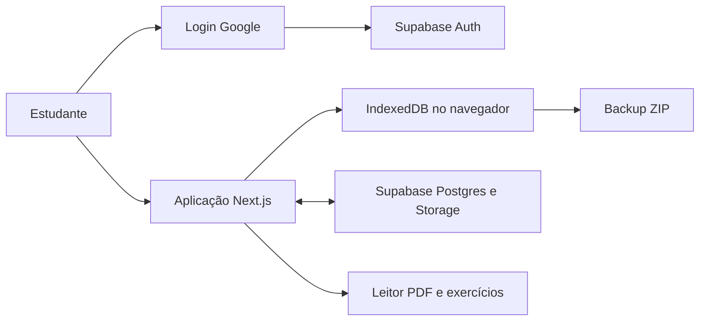

# Gevyro Aviation Academy

<p align="center">
  
</p>

<p align="center"><strong>Um espaço digital para organizar os estudos de Mecânica de Manutenção Aeronáutica.</strong></p>

<p align="center">
  <a href="https://gevyro-aviation-academy.vercel.app">Abrir a Gevyro Aviation Academy</a>
</p>


## Sobre o projeto

A **Gevyro Aviation Academy** é uma plataforma de estudos criada para apoiar a formação em Mecânica de Manutenção Aeronáutica (MMA). Ela reúne apostilas, leitura de PDFs, exercícios, simulados, inglês técnico e ferramentas de organização em um único ambiente.

O projeto nasceu de uma necessidade prática: tornar mais fácil estudar a partir de materiais de curso que estavam separados em vários PDFs. A proposta foi organizar esses materiais em uma rotina de estudo utilizável, permitir que o estudante acompanhe a leitura e as respostas e oferecer atividades para revisar os assuntos do curso.

A Gevyro foi desenvolvida como uma ferramenta educacional pessoal. Ela não é uma escola certificadora, não substitui aulas, instrutores, manuais aprovados ou procedimentos de manutenção, e não representa seus exercícios como questões oficiais da ANAC.

## O que é possível fazer

- **Consultar o acervo do curso:** abrir 12 materiais de MMA Básico, incluindo capítulos técnicos, CRM, segurança de voo e a apostila de exercícios do aluno.
- **Ler e organizar PDFs:** importar documentos pessoais, acompanhar páginas, pesquisar texto indexado, criar destaques, desenhos e anotações.
- **Praticar os conteúdos:** usar 12 cadernos autorais com 20 questões cada, registrar respostas, revisar erros e montar simulados.
- **Estudar inglês técnico:** aprender vocabulário e interpretação de manuais, fazer exercícios e praticar pronúncia com os recursos de voz disponíveis no navegador.
- **Planejar a rotina:** registrar sessões de estudo, organizar tarefas e metas e acompanhar indicadores de desempenho.
- **Revisar com flashcards:** criar cartões e usar repetição espaçada para retomar conteúdos.
- **Usar ferramentas de apoio:** consultar calculadoras educacionais relacionadas ao estudo aeronáutico.
- **Fazer backup:** exportar registros e arquivos para um ZIP com manifesto e verificação de integridade, e restaurar esse arquivo posteriormente.

## Imagens do projeto

O logotipo e a fotografia abaixo fazem parte da identidade visual usada pela aplicação.

<p align="center">
  
</p>


## Como o sistema funciona

O aplicativo combina armazenamento local com sincronização opcional por conta Google:

1. O estudante entra com Google pelo Supabase Auth.
2. Os registros de estudo ficam disponíveis no navegador e são armazenados localmente com IndexedDB, por meio do Dexie. Isso permite continuar usando parte dos recursos sem conexão.
3. Quando há sessão autenticada e conexão, o aplicativo sincroniza os registros com o Supabase. As tabelas próprias da academia usam o prefixo `gaa_` e a migração define políticas de acesso por usuário.
4. PDFs importados pelo estudante são enviados ao bucket privado `gaa-documents`, com acesso organizado por usuário. Os PDFs fixos em `public/apostilas` são arquivos estáticos e podem ser acessados por URL direta.
5. O backup permite manter uma cópia independente dos dados do navegador e dos arquivos locais.



## Tecnologias

| Área | Tecnologia |
| --- | --- |
| Aplicação web | Next.js App Router, React e TypeScript |
| Interface | CSS, Tailwind CSS e componentes Radix |
| Autenticação | Supabase Auth com OAuth do Google |
| Banco e arquivos | Supabase Postgres, Row Level Security e Storage |
| Persistência no navegador | IndexedDB com Dexie |
| PDFs | PDF.js para leitura e PDF-lib para exportações |
| Reconhecimento de texto | Tesseract.js para OCR local |
| Exercícios e validação | TypeScript e Zod |
| Aplicação instalável | Recursos de PWA e service worker |
| Hospedagem | Vercel |

## Organização do repositório

```text
src/
  app/                 Rotas Next.js e retorno do login Google
  components/          Estrutura principal, painel, anotações e configurações
  lib/                 Banco local, tipos, validação e conteúdo inicial
  modules/
    auth/              Cliente Supabase e experiência de login
    backup/            Exportação e restauração de backups
    english/           Curso, exercícios e vocabulário de inglês técnico
    exercises/         Cadernos, simulados, respostas e exportação
    library/            Biblioteca de documentos e materiais fixos
    reader/             Leitor e ferramentas de estudo em PDF
    sync/               Sincronização com Supabase e upload de PDFs
    ...                 Flashcards, planejamento e calculadoras
public/
  apostilas/           Materiais fixos do curso
  gevyro-hangar.jpg    Fotografia da identidade visual
supabase/
  migrations/          Estrutura do banco, policies e bucket
docs/                   Estado do projeto e mapeamento dos cadernos MMA
tests/                  Testes automatizados e verificações SQL
```

## Conteúdo educacional

Os 12 cadernos autorais totalizam 240 questões de revisão organizadas por temas das apostilas e pelo currículo mínimo do módulo básico da [IS ANAC 141-007, Revisão D](https://pergamum.anac.gov.br/pergamum/vinculos/IS141-007D.pdf). As questões e seus gabaritos são conteúdo de estudo da Gevyro: **não são questões oficiais da ANAC** e ainda precisam de revisão técnica de instrutor.

A maioria dos PDFs técnicos fornecidos tem páginas digitalizadas como imagem. O conteúdo dos cadernos foi organizado a partir dos materiais, dos sumários legíveis e da referência curricular; não representa uma extração exaustiva página a página. O documento [docs/MMABAS.md](docs/MMABAS.md) detalha os temas, fontes e limitações.

O curso de inglês técnico usa como referência o guia enviado para o projeto e acrescenta atividades autorais de leitura, vocabulário, escrita e pronúncia. A síntese de voz e o reconhecimento de fala dependem do suporte do navegador e da permissão do microfone.

## Executar localmente

### Requisitos

- Node.js 22 ou superior
- npm
- Docker, caso deseje executar uma instância local do Supabase

### Instalação

```bash
npm ci
cp .env.example .env.local
npm run dev
```

O servidor de desenvolvimento estará disponível em `http://localhost:3000`.

Sem credenciais Supabase, a aplicação pode ser explorada no modo local disponível, com dados somente no navegador. Esse modo não sincroniza entre dispositivos e não protege os dados locais com uma senha da Gevyro. O navegador pode apagar o IndexedDB; faça backups regulares.

### Variáveis de ambiente

| Variável | Finalidade |
| --- | --- |
| `NEXT_PUBLIC_SUPABASE_URL` | URL do projeto Supabase usado pelo aplicativo |
| `NEXT_PUBLIC_SUPABASE_PUBLISHABLE_KEY` | Chave publishable do Supabase, apropriada para uso no cliente junto com RLS |
| `NEXT_PUBLIC_SITE_URL` | URL pública da aplicação em produção |
| `NEXT_PUBLIC_STORAGE_LIMIT_BYTES` | Limite usado pela interface para armazenamento |

O arquivo [.env.example](.env.example) contém valores de exemplo. Não coloque `service_role`, senha do banco, segredo OAuth ou outras credenciais privadas em variáveis `NEXT_PUBLIC_`, no código do navegador ou no Git.

## Configuração do Google e Supabase

1. No Supabase, habilite Google em **Authentication → Sign In / Providers** e configure as credenciais OAuth do Google.
2. No Google Cloud, cadastre como URI de redirecionamento OAuth do provedor:

   ```text
   https://bcfjhwcsulylodayczkr.supabase.co/auth/v1/callback
   ```

3. Na configuração de URLs de autenticação do Supabase, permita o retorno da Gevyro:

   ```text
   https://gevyro-aviation-academy.vercel.app/auth/callback
   ```

4. Configure `NEXT_PUBLIC_SITE_URL=https://gevyro-aviation-academy.vercel.app` no ambiente de produção da Vercel.

**Atenção: o projeto Supabase é compartilhado com outras aplicações.** A lista de Redirect URLs aceita vários domínios: acrescente o callback da Gevyro e preserve os callbacks que já existem. O campo global **Site URL** é o destino padrão quando um callback não é permitido; não o troque sem avaliar o efeito sobre as outras aplicações. Para desenvolvimento local, permita também `http://localhost:3000/auth/callback`.

O fluxo de login começa em `/auth/google` e finaliza em `/auth/callback`. A implementação está em `src/app/auth/`.

## Banco de dados e implantação

A migração principal está em [`supabase/migrations/20261126192859_academy_schema.sql`](supabase/migrations/20261126192859_academy_schema.sql). Ela cria tabelas com prefixo `gaa_`, políticas RLS por proprietário e o bucket `gaa-documents`. O projeto Supabase também contém outros sistemas; revise cuidadosamente o destino antes de aplicar qualquer alteração e não remova ou renomeie tabelas que não pertençam à Gevyro.

Para sincronização remota, configure no ambiente de produção da Vercel:

- `NEXT_PUBLIC_SUPABASE_URL`
- `NEXT_PUBLIC_SUPABASE_PUBLISHABLE_KEY`
- `NEXT_PUBLIC_SITE_URL`
- `NEXT_PUBLIC_STORAGE_LIMIT_BYTES`

O endereço associado à aplicação é [gevyro-aviation-academy.vercel.app](https://gevyro-aviation-academy.vercel.app). O acesso efetivo depende das configurações de implantação e autenticação da Vercel.

## Privacidade e armazenamento dos PDFs

Há duas formas de armazenamento de PDF no projeto:

- **Materiais fixos do curso:** estão em `public/apostilas` para aparecer no acervo da academia. Como fazem parte dos arquivos públicos da aplicação, seus links diretos não exigem login.
- **Documentos importados pelo estudante:** podem ser armazenados no navegador e sincronizados no bucket privado `gaa-documents`, com políticas de acesso por usuário.

Não coloque documentos pessoais ou confidenciais em `public/`. Se as apostilas fixas também precisarem ficar acessíveis somente após login, será necessário movê-las para o bucket privado e servi-las com autorização.

## Backup

Em Configurações, o estudante pode exportar um ZIP com manifesto, registros e arquivos disponíveis localmente. O manifesto inclui hashes SHA-256 para detectar divergências durante a restauração. Guarde uma cópia fora do dispositivo: o backup não é automaticamente uma cópia em outro aparelho.

## Comandos úteis

```bash
npm run dev          # iniciar o desenvolvimento
npm run lint         # verificar estilo e problemas estáticos
npm run typecheck    # verificar tipos TypeScript
npm test             # executar testes unitários
npm run test:e2e     # executar testes de ponta a ponta
npm run build        # gerar build de produção
npm run db:start     # iniciar Supabase local com Docker
npm run db:reset     # recriar o banco local a partir das migrations
```

## Créditos

A fotografia do hangar usada na identidade visual é de [Adam Roye no Unsplash](https://unsplash.com/photos/private-jet-parked-in-a-hangar-with-sun-flare-E1oCDZQiIZU). Os logotipos Gevyro são os arquivos próprios do projeto.

---

**Gevyro Aviation Academy** · Conhecimento em terra. Confiança para ir além.
